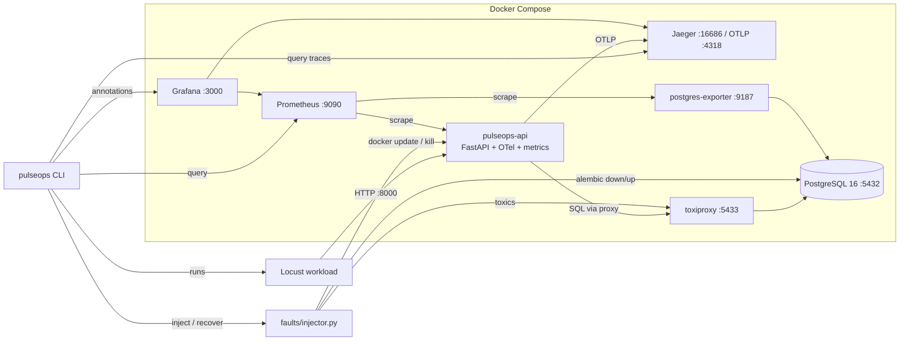

# PulseOps — Production Reliability Engineering Platform

PulseOps runs a small, real orders API (FastAPI + PostgreSQL), observes it with metrics, traces and logs,
and breaks it on purpose with six controlled failures. For each failure it detects the problem, diagnoses
it from evidence with deterministic rules, applies the fix, and verifies recovery on the same load.
Every number in a report comes from a run on this repo; nothing is simulated by labels.

## Architecture



Details: [docs/ARCHITECTURE.md](docs/ARCHITECTURE.md).

## 5-minute quickstart

Needs Docker (Compose v2), Python 3.12, `make`. Run from a Linux/WSL2 shell.

```bash
cp .env.example .env     # then set JWT_SECRET (placeholder is marked in the file)
make up                  # build + start the stack (the API container runs migrations on start)
make seed                # SEED_USERS/PRODUCTS/ORDERS from .env; see .env.example for sizes
make load-normal         # steady Locust load, so dashboards have data
# open Grafana: http://localhost:3000  ("PulseOps - Service Health", "PulseOps - DB & Pool")
make scenario S=S4_missing_index
```

Other scenario ids: `S1_db_latency`, `S2_db_outage`, `S3_pool_exhaustion`, `S5_cpu_throttle`,
`S6_crash_restart`. Each run writes `reports/<run_id>/{report.md, evidence.json, locust_stats.csv}`.
Other useful targets: `make test`, `make lint`, `make reset` (wipes volumes).

## Screenshots (to be added after a real run)

- [ ] `docs/img/grafana-service-health.png` — RED dashboard during a scenario, INJECT/FIX annotations visible
- [ ] `docs/img/grafana-db-pool.png` — pool checked-out vs size during S3
- [ ] `docs/img/jaeger-slow-trace.png` — S4 trace showing the dominant SQL span
- [ ] `docs/img/prometheus-alert-firing.png` — alert firing during a scenario
- [ ] `docs/img/report-s4.png` — rendered `report.md` of an S4 run

## Repo map

| Path | What |
|------|------|
| `app/` | FastAPI app: `api/` routes, `auth/`, `db/`, `obs/` (logs, metrics, tracing), `reliability/policy.py` |
| `migrations/`, `scripts/seed.py` | Alembic migrations (0002 is the S4 index), bulk SQL seed |
| `deploy/observability/` | Prometheus config + alert rules, Grafana provisioning + dashboards |
| `workload/` | Locust profiles: `normal`, `burst`, `pool_pressure` |
| `faults/` | Toxiproxy config, `scenarios.yaml`, `injector.py` (inject / recover) |
| `cli/` | Experiment runner, diagnosis rules, report writer (`python -m cli`) |
| `tests/` | `pN_*` per-part tests; `e2e/` against a running stack; `conftest.py` shared fixtures |
| `docs/` | Architecture, decisions, defence map, runbooks `S1..S6`, results template, CV ledger |
| `.github/workflows/ci.yml` | lint, tests (Postgres service), pip-audit, docker build + compose config, manual e2e |
| `reports/` | Generated at runtime, gitignored |

## What this project does NOT claim

- Not production-ready or scalable: it is laptop-scale, reproducible fault-injection experiments.
- No result is a benchmark. Reports are single runs (N=1) on one machine; see the caveats in each `report.md`.
- Diagnosis is a small rule table over metric/trace evidence, not ML root-cause analysis. It can return `UNKNOWN`.
- No Alertmanager, no paging, no multi-instance or multi-region setup, no Kubernetes.
- Trace sampling is 100% and scrape/evaluation intervals are demo-scale; see [docs/DECISIONS.md](docs/DECISIONS.md).
- Built AI-assisted; design decisions are documented and defensible from the code ([docs/DEFENCE.md](docs/DEFENCE.md)).
- Measured results live only in [docs/RESULTS.md](docs/RESULTS.md); empty means not measured.
