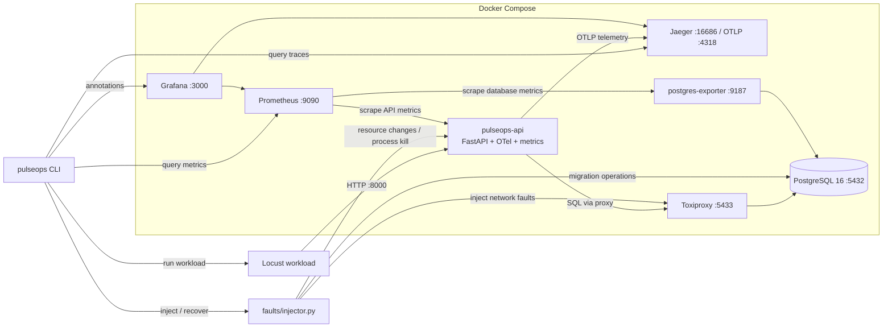

# PulseOps — Production Reliability Engineering Platform

**A hands-on reliability engineering platform for controlled fault injection, observability, diagnosis, and recovery verification.**

PulseOps runs a real orders API built with FastAPI and PostgreSQL. It observes service behaviour through metrics, traces, and logs, then introduces six controlled failure scenarios to investigate how the system responds.

For each scenario, the platform is designed to detect abnormal behaviour, diagnose the failure using telemetry and deterministic rules, apply a corrective action, and verify recovery under workload.

The project focuses on **reproducible experiments and evidence-driven reliability engineering** rather than simulated dashboards or unsupported performance claims.

> **Project status:** Active development and validation. See the testing and results documentation for the current state of verification.

## Architecture

PulseOps integrates the API, database, workload generator, observability stack, and fault-injection tooling in a Docker Compose environment.



**Architecture details:** [`docs/ARCHITECTURE.md`](docs/ARCHITECTURE.md)

## What problem does PulseOps address?

When a backend service becomes slow or unavailable, observing an error is not enough. Engineers need to correlate symptoms with telemetry, investigate possible causes, perform recovery actions, and determine whether the service has returned to an acceptable state.

PulseOps provides a controlled environment for exploring this workflow:

1. Generate workload against a real API.
2. Observe application and database behaviour.
3. Inject a predefined failure.
4. Inspect metrics and distributed traces.
5. Evaluate diagnostic evidence using deterministic rules.
6. Recover the system and evaluate its behaviour under workload.
7. Store experiment output for further analysis.

The purpose is to make failure investigation and recovery measurable and repeatable.

## Technology stack

| Component | Technology | Purpose |
|---|---|---|
| Backend | FastAPI, Python | Orders API and application logic |
| Database | PostgreSQL 16 | Persistent application data |
| Containers | Docker Compose | Local development and service orchestration |
| Metrics | Prometheus | Metrics collection and alert-rule evaluation |
| Dashboards | Grafana | Service health and database observability |
| Tracing | OpenTelemetry, Jaeger | Distributed request tracing |
| Load testing | Locust | Workload generation and request statistics |
| Fault injection | Toxiproxy | Controlled database-network disruptions |
| Database migrations | Alembic | Schema changes |
| Testing | Pytest | Automated validation |

## Reliability scenarios

PulseOps defines six scenarios for investigating different classes of failure.

| Scenario | Failure mode | Investigation focus |
|---|---|---|
| `S1_db_latency` | Database latency | Request latency and database delays |
| `S2_db_outage` | Database connectivity failure | Request errors and recovery behaviour |
| `S3_pool_exhaustion` | Database connection-pool pressure | Pool utilisation and request behaviour |
| `S4_missing_index` | Missing database index | Query performance and trace evidence |
| `S5_cpu_throttle` | CPU throttling | Resource pressure and service latency |
| `S6_crash_restart` | Process crash and restart | Service interruption and recovery |

These scenarios provide the basis for controlled experiments. Their actual outcomes must be established from run reports; scenario definitions alone do not prove that a failure was diagnosed correctly or that recovery targets were met.

## Observability and diagnosis

PulseOps combines telemetry from multiple components to investigate service behaviour.

- **Metrics:** Prometheus collects configured application and database metrics.
- **Dashboards:** Grafana provides views for service health and database/connection-pool behaviour.
- **Distributed traces:** OpenTelemetry instrumentation exports telemetry to Jaeger for request-level investigation.
- **Fault annotations:** Experiment actions can be correlated with observed behaviour where configured.
- **Deterministic diagnosis:** Rules evaluate available metric and trace evidence. The diagnosis may return `UNKNOWN` when evidence is insufficient.
- **Experiment reports:** Run-specific artifacts capture the available measurements and diagnostic output.

The diagnostic engine is rule-based. It is not an ML-based root-cause analysis system.

## Quickstart

### Prerequisites

- Docker Engine or Docker Desktop with Docker Compose v2
- Python 3.12
- `make`
- A Linux or WSL2 shell

### 1. Get the repository

```bash
git clone https://github.com/Mr-Indora/pulseops.git
cd pulseops
```

### 2. Configure the environment

```bash
cp .env.example .env
```

Set the required environment values in `.env`, including a suitable local `JWT_SECRET`. Use the example file to understand the supported seed-data configuration. Do not commit `.env` or real credentials.

### 3. Build and start the stack

```bash
make up
make seed
```

The API container is configured to run migrations during startup. The seed command uses the project's configured seed-data settings.

### 4. Generate workload

```bash
make load-normal
```

This runs the normal Locust workload and provides traffic for the observability stack.

### 5. Inspect the dashboards

Open Grafana at [http://localhost:3000](http://localhost:3000).

The configured dashboards include:

- `PulseOps - Service Health`
- `PulseOps - DB & Pool`

Dashboard data depends on the running services and generated workload.

### 6. Run a fault-injection scenario

```bash
make scenario S=S4_missing_index
```

Other scenario identifiers are listed in the reliability scenarios table above.

**Warning:** These scenarios deliberately disrupt service behaviour or alter resource and database state. Run them only in the intended development environment.

### Useful development commands

```bash
make test
make lint
make reset
```

`make reset` is destructive: it wipes configured volumes. Review the Makefile and back up any data you need before running it.

## Experiment reports and measurements

Experiment artifacts are written under a run-specific directory:

```text
reports/<run_id>/
├── report.md
├── evidence.json
└── locust_stats.csv
```

The expected artifacts are:

- `report.md` — experiment summary and available measurements
- `evidence.json` — structured diagnostic evidence
- `locust_stats.csv` — Locust statistics

Reports should be used to investigate observed failure behaviour, diagnosis, recovery, latency, and request errors. Results can vary with the host machine, workload, timing, and system state.

A single run is an observation, not a statistically validated benchmark. For stronger conclusions, repeat experiments under comparable conditions and report the variability.

See [`docs/RESULTS.md`](docs/RESULTS.md) for the project's results record.

## Screenshots and visual evidence

The following genuine screenshots are planned for the project showcase. They should be added only after the corresponding scenarios have been run and the images have been captured.

- [ ] `docs/img/grafana-service-health.png` — service health during a scenario, with relevant fault and recovery annotations
- [ ] `docs/img/grafana-db-pool.png` — connection-pool behaviour during `S3_pool_exhaustion`
- [ ] `docs/img/jaeger-slow-trace.png` — trace evidence from `S4_missing_index`
- [ ] `docs/img/prometheus-alert-firing.png` — a verified alert firing during a scenario
- [ ] `docs/img/report-s4.png` — a representative experiment report

Until these files exist, the checklist represents planned evidence, not completed demonstrations.

## Repository structure

| Path | Purpose |
|---|---|
| `app/` | FastAPI routes, authentication, database access, observability, reliability policy |
| `migrations/`, `scripts/seed.py` | Alembic migrations and seed-data generation |
| `deploy/observability/` | Prometheus configuration, alert rules, Grafana provisioning and dashboards |
| `workload/` | Locust profiles: `normal`, `burst`, `pool_pressure` |
| `faults/` | Toxiproxy configuration, scenario definitions, fault injector |
| `cli/` | Experiment runner, diagnostic rules and report writer |
| `tests/` | Automated tests, shared fixtures and end-to-end tests |
| `docs/ARCHITECTURE.md` | Detailed architecture |
| `docs/DECISIONS.md` | Design decisions and trade-offs |
| `docs/DEFENCE.md` | Technical design rationale |
| `docs/INTEGRATION_LOG.md` | Integration notes |
| `docs/runbooks/` | Scenario-specific runbooks for `S1`–`S6` |
| `docs/RESULTS.md` | Measured results record |
| `docs/CV_BULLETS.md` | Project accomplishment notes |
| `.github/workflows/ci.yml` | Continuous integration configuration |
| `reports/` | Generated experiment artifacts; gitignored |

## Testing and validation

The project includes automated tests and a CI workflow configured for checks such as linting, tests, dependency auditing, Docker builds, and Compose validation. End-to-end checks may require a running stack.

Run the local checks with:

```bash
make test
make lint
```

The commands' actual exit status and output determine whether the checks pass.

**Validation status:** Do not interpret the presence of test files or a CI workflow as proof that every test passes. Likewise, do not claim all six failure scenarios meet recovery targets unless supported by verified run artifacts.

## Design decisions and limitations

PulseOps is a local reliability-engineering environment intended for controlled experiments and technical demonstration.

- **Deployment scope:** The current design is laptop-scale and is not presented as a production-ready deployment.
- **Benchmarking:** Individual runs are not statistically validated performance benchmarks.
- **Diagnosis:** The engine uses deterministic rules over telemetry; it can return `UNKNOWN` and does not perform ML-based root-cause analysis.
- **Infrastructure scope:** The project does not claim a multi-instance, multi-region, or Kubernetes deployment.
- **Incident response:** Metrics and alert rules do not imply a complete paging or incident-management system.
- **Telemetry settings:** Trace sampling and scrape/evaluation intervals are configured for the demonstration environment.

For more context, see [`docs/DECISIONS.md`](docs/DECISIONS.md) and [`docs/DEFENCE.md`](docs/DEFENCE.md).

## Project goals

- [ ] Capture genuine observability screenshots for representative scenarios.
- [ ] Publish a sanitized, reproducible example report.
- [ ] Repeat experiments to assess measurement variability.
- [ ] Document actual diagnosis and recovery outcomes for all six scenarios.
- [ ] Keep test status and measured results aligned with the latest verified runs.

These items should be marked complete only when the corresponding evidence exists.

## What PulseOps demonstrates

The project is designed to showcase practical work in:

- Backend API engineering
- PostgreSQL and connection-pool behaviour
- Metrics, logs, and distributed tracing
- Docker-based service orchestration
- Controlled fault injection
- Evidence-driven diagnosis
- Load testing and recovery verification
- Automated testing and technical documentation

The strongest demonstration of PulseOps will be a reproducible experiment with real telemetry, a clear diagnosis, and a verified recovery—not an unsupported claim in project documentation.

---

**Author:** [Mr-Indora](https://github.com/Mr-Indora)  
**Repository:** [github.com/Mr-Indora/pulseops](https://github.com/Mr-Indora/pulseops)
